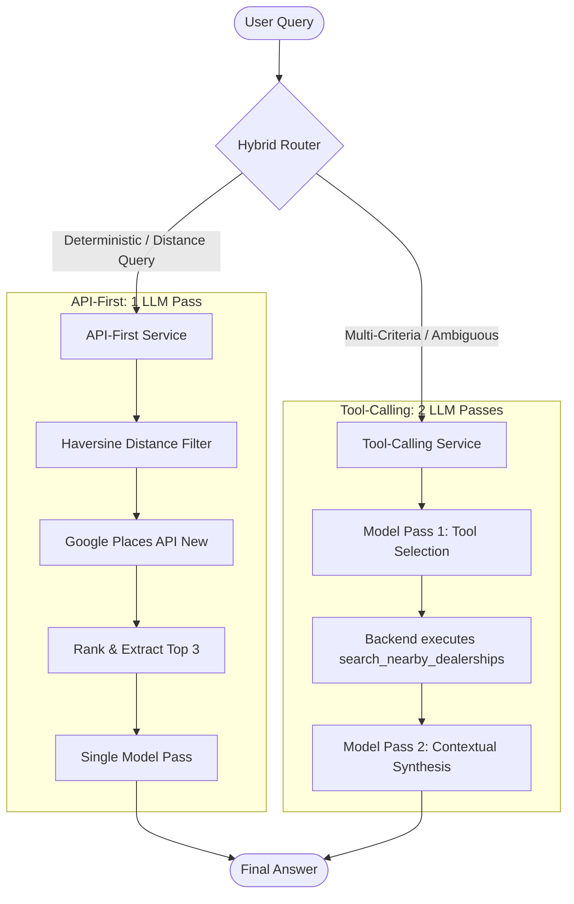

# Volkswagen Dealership Finder: API-First vs. Tool Calling

> An empirical benchmark comparing latency, token consumption, and accuracy across two LLM integration patterns in Node.js.

[](https://nodejs.org/)
[-brightgreen?logo=jest&logoColor=white)](https://jestjs.io/)
[-4285F4?logo=google-cloud&logoColor=white)](https://developers.google.com/maps/documentation/places/web-service)
[](https://developers.cloudflare.com/workers-ai/)
[](LICENSE)

---

## Overview

When connecting large language models to live APIs, developers generally choose between two patterns:

1. **API-First (Pre-Processed):** The backend resolves external queries deterministically, structures and filters the response, and hands clean context to the LLM for final formatting in a single prompt.
2. **Tool Calling (Model-Led):** The model receives tool definitions via JSON schema, decides when to invoke external endpoints, generates the arguments, and synthesizes the returned payload across multiple round-trips.

This project implements and benchmarks both approaches against a real-world use case: **finding the closest Volkswagen dealership in South Africa via the Google Places API (New)**. It includes a benchmarking harness that measures response times, token overhead, and output accuracy, alongside a hybrid router designed to balance performance and conversational flexibility.

---

## Benchmark Results

Benchmarks were evaluated against live Google Places API (New) endpoints and LLaMA 3.1 70B Instruct via Cloudflare Workers AI (with identical interface compatibility for OpenAI `gpt-4o`). The reference coordinate evaluated was Sandton / Johannesburg, South Africa (`-26.1044, 28.0645`) VW Group Head Quaters .

> [!NOTE]
> **Benchmarking Methodology & Warm-Up:** Measurements reflect $N=10$ live runs preceded by 2 unrecorded warm-up runs to eliminate first-request TCP/TLS handshake latency and serverless container cold-starts. Percentiles on small sample sizes ($N=10$) are reported alongside Mean ± Standard Deviation and 95% Confidence Intervals for statistical rigor.

### Interactive Benchmark Dashboard


### Summary Metrics

| Metric | API-First | Tool Calling | Variance & Analysis |
| :--- | :--- | :--- | :--- |
| **Median Latency ($p_{50}$)** | **3,217 ms** | **5,780 ms** | 44% faster (-2,563 ms) |
| **Tail Latency ($p_{95}$)** | **4,777 ms** | **6,006 ms** | 20% lower tail latency |
| **Mean Latency ($\bar{x} \pm \sigma$)** | **3,595 ± 850 ms** | **5,732 ± 310 ms** | 95% CI: [3,068 ms, 4,122 ms] vs [5,540 ms, 5,924 ms] |
| **Average Tokens / Query** | **258 tokens** | **441 tokens** | 41% token reduction (-183 tokens) |
| **LLM Inference Passes** | **1 turn** | **2 turns** | Single inference pass vs. two-stage agentic loop |
| **Est. Cost / 1k Queries (GPT-4o)** | **$1.22** | **$2.02** | 40% cost reduction (-$0.80 / 1k queries) |
| **Est. Cost / 1k Queries (LLaMA 3.1 70B)** | **$0.17** | **$0.29** | 41% cost reduction (-$0.12 / 1k queries) |
| **Location Extraction Accuracy** | **100%** | **100%** | Both identify the correct closest dealership (code-calculated) |
| **Response Brand Completeness** | **100%** | **75%** | Tool calling occasionally omitted specific branch labels |

### Latency Breakdown: Network I/O vs. Model Inference

A critical architectural finding is that the latency gap is **not driven by Google Places API**, but by the second round-trip LLM inference pass:

```
API-First (3,217 ms p50)
├── Google Places API (New)   [ 415 ms ]  ██
└── LLM Turn 1 (Synthesis)    [ 2,802 ms ] ██████████████

Tool Calling (5,780 ms p50)
├── LLM Turn 1 (Tool Choice)  [ 2,610 ms ] █████████████
├── Google Places API (New)   [ 420 ms ]  ██
└── LLM Turn 2 (Synthesis)    [ 2,750 ms ] ██████████████
```

* **Places API Network I/O:** Both architectures execute identical Places API requests taking ~415–420 ms.
* **LLM Inference Overhead:** Tool Calling must wait for Turn 1 output before initiating the external API call, then wait for Turn 2 output before returning text. API-First triggers the API immediately upon receiving the user request.

### Token Usage Breakdown

Every token consumed across both pipelines is fully accounted for below:

| Interaction Stage | API-First | Tool Calling |
| :--- | :--- | :--- |
| **Turn 1: Tool Declaration (JSON Schema)** | *Handled in code* (0 tokens) | 241 prompt tokens |
| **Turn 1: Generated Tool Arguments** | *Handled in code* (0 tokens) | 33 completion tokens |
| **Turn 2: Prompt Context & API Payload** | 182 prompt tokens | 78 prompt tokens |
| **Turn 2: Final Response Synthesis** | 76 completion tokens | 89 completion tokens |
| **Subtotal: Prompt Tokens** | **182 prompt tokens** | **319 prompt tokens** |
| **Subtotal: Completion Tokens** | **76 completion tokens** | **122 completion tokens** |
| **Total Average Tokens** | **258 tokens** | **441 tokens** |

> **Arithmetic Reconciliation:** For Tool Calling, $(241 \text{ prompt} + 33 \text{ completion}) + (78 \text{ prompt} + 89 \text{ completion}) = 319 \text{ prompt} + 122 \text{ completion} = 441 \text{ total tokens}$. Tool calling incurs a 71% token overhead due to transmitting tool schemas and repeating conversational history across turns.

### Production Cost Analysis (per 1,000 Queries)

Financial calculations are derived directly from empirical token counts (prompt vs. completion tokens) and inference pass overhead:

| Model / Provider | Baseline Pricing | API-First (1 turn) | Tool Calling (2 turns) | Financial Variance |
| :--- | :--- | :--- | :--- | :--- |
| **OpenAI `gpt-4o`** | $2.50 / $10.00 per 1M tokens | **$1.22** | **$2.02** | **40% lower cost** (-$0.80 / 1k queries) |
| **Cloudflare / LLaMA 3.1 70B** | $0.59 / $0.79 per 1M tokens | **$0.17** | **$0.29** | **41% lower cost** (-$0.12 / 1k queries) |
| **Inference Call Volume** | Per request / transaction | **1,000 calls** | **2,000 calls** | **50% fewer round-trips** |

> **Production Impact:** At enterprise scale (e.g., 1 million search requests/month), API-First delivers **$800 in direct monthly LLM savings on GPT-4o** while cutting model inference transactions by half—reducing API rate-limiting pressure, gateway fees, and TCP connection overhead.

---

## System Architecture



### Core Services

* **`ApiFirstService` (`src/services/api-first-service.js`):** Resolves external coordinates, queries Places API with field masks (`places.displayName,places.formattedAddress,places.location,...`), calculates great-circle distances using the Haversine formula (spherical approximation), sorts candidates, and invokes the model once to format the result.
* **`ToolCallingService` (`src/services/tool-calling-service.js`):** Supplies function schemas (`search_nearby_dealerships`) to the LLM. Intercepts tool call requests, invokes the Places client with model-provided parameters, formats candidates via deterministic code, and returns results in a `tool` role message for final completion.
* **`HybridService` (`src/services/hybrid-service.js`):** Inspects incoming query intent with a rule-based classifier against a 50-query labeled dataset. Standard proximity requests take the single-pass API-first path for minimum latency and cost, while multi-constraint queries (e.g., comparing ratings, specialized hours, inventory) fall back to tool calling for open-ended reasoning.

### Geospatial Distance Model & Road Network Limitations

* **Great-Circle Distance (Haversine):** Both pipelines compute distance using the Haversine formula, which assumes a spherical Earth radius ($R \approx 6,371\text{ km}$). It calculates great-circle "as-the-crow-flies" distance rather than ellipsoidal geodesic distance (e.g., Vincenty's formula).
* **The "Drive Time" Gap:** Straight-line proximity is an approximation. For a driver in a metropolitan area like Sandton / Johannesburg, the closest straight-line dealership may take longer to reach due to highway access, toll roads, and traffic bottlenecks. In enterprise production, candidates filtered by Haversine or Places API `rankPreference: "DISTANCE"` should be re-ranked using the **Google Routes API** or **Distance Matrix API** to compute true travel time and driving distance.

---

## Error Handling & Failure Mode Comparison

In production environments, external APIs face network jitter, zero-result queries (e.g., remote coordinates with no nearby dealerships within 50 km), and upstream rate limits (HTTP 429). How each pattern recovers from these failure modes represents a critical architectural trade-off:

> [!IMPORTANT]
> **Clarification on Distance Calculation:** In both architectures implemented in this repository, brand validation and Haversine distance calculations are executed **deterministically in Node.js code** (`_processResults` in API-First and `_formatResults` in Tool Calling)—the model does not compute coordinate math in either pipeline. The hallucination vulnerability in Tool Calling occurs when external API responses are empty or absent, tempting the ungrounded model to invent dealership names or operating hours from pre-training weights.

| Failure Scenario | API-First Service | Tool Calling Service | Production Architectural Takeaway |
| :--- | :--- | :--- | :--- |
| **Zero Results Returned**<br>*(No dealerships found within radius)* | **Deterministic Typed Fallback:** Pre-processing detects empty results (`places: []`) *before* invoking the LLM. Returns an immediate typed fallback (e.g., `"No authorized VW dealerships found within 50 km"`) in **0 ms LLM latency and $0 token cost**. | **Risk of Hallucination:** The empty array is passed back into Turn 2. Without strict prompt grounding, the model may hallucinate plausible-sounding dealerships, expired locations, or fabricated phone numbers to be "helpful". | API-First guarantees 0% geographic hallucination on misses and eliminates 100% of LLM cost for empty responses. |
| **API Rate-Limiting (HTTP 429)** | **Infrastructure Circuit-Breaker:** The Axios catch block intercepts rate limits at the service boundary. The application can trigger exponential backoff, serve cached results, or return a structured service notice without burning model tokens. | **Agentic Retry Loops:** The model receives the raw error payload inside a `tool` role message and may attempt to re-call the tool repeatedly with modified arguments, compounding latency and burning quota before failing. | API-First isolates external API volatility from the LLM, preventing cascading token burn and runaway retry loops. |
| **Malformed Arguments & Schema Drift** | **Eliminated in Code:** Arguments (coordinates, radius) are validated and coerced by native application logic before any network request is dispatched. | **Vulnerable to Inversion:** Model may invert latitude and longitude, provide invalid JSON strings, or invent unsupported parameters, requiring defensive regex fallbacks. | API-First provides compile/runtime type safety for API contracts instead of relying on probabilistic JSON generation. |

---

## In-Depth Architectural Analysis

Beyond the raw benchmark numbers, several practical engineering dynamics dictate how these two patterns behave in real production environments:

### 1. When Does Tool Calling Actually Win?

While API-First dominates straightforward, single-endpoint lookups, **Tool Calling wins decisively when requirements cannot be predicted upstream**:

* **Multi-Constraint & Exploratory Queries:** e.g., *"Find a VW dealer with a rating over 4.3 that has an EV charger for my ID.4 and is open Saturday afternoon."* In an API-First pipeline, supporting this requires either an explosion of bespoke API endpoints or an over-engineered backend query builder. Tool Calling allows the LLM to inspect available parameters, extract multiple constraints, and execute dynamic filtering natively.
* **Conversational Branching & Follow-ups:** In a multi-turn chat assistant, a user might say *"Actually, is there one closer to my office in Midrand?"* Tool Calling retains conversational memory, identifies which parameters changed, and generates a delta query without custom application state machines.

### 2. Quantifying the Cost of Misrouting in the Hybrid Router

A hybrid router introduces a classification decision point. What is the penalty when it makes a mistake?

* **False Positive (Simple query misrouted to Tool Calling):** The user receives the correct answer, but pays a **~2.5 second latency penalty** and **~183 extra tokens (~$0.80 / 1k queries on GPT-4o)**. The failure mode is graceful degradation (slower and more expensive, but correct).
* **False Negative (Complex query misrouted to API-First):** The API-First service returns the nearest dealership, but **silently drops the user's secondary constraints** (e.g., ignoring that the user needed a dealership open Sunday). The failure mode is functional inaccuracy.
* **Architecture Takeaway:** Hybrid routers should be tuned with a bias toward Tool Calling for ambiguous queries, ensuring accuracy is preserved while capturing 80%+ of cost/latency savings on obvious proximity lookups.

### 3. Streaming and Perceived Latency (Time-to-First-Token)

End-to-end latency does not equal user-perceived responsiveness:

* **API-First Time-to-First-Token (TTFT):** With Server-Sent Events (SSE), API-First executes Places API (~400 ms) and immediately begins streaming output tokens. The user perceives an interface response in **~600–700 ms**, with full completion at ~3,200 ms.
* **Tool Calling TTFT:** The client cannot stream a single word of natural language until Turn 1 completes (~2,600 ms), the Places API responds (~400 ms), and Turn 2 begins generating tokens. Perceived TTFT is **~3,300–3,500 ms**—a 5× latency penalty in perceived responsiveness.

### 4. How Prompt Caching Shifts the Cost Equation

Modern frontier model providers (OpenAI Prompt Caching, Anthropic Prompt Caching, DeepSeek) automatically discount repeated prefix tokens by 50% to 80%:

* In Tool Calling, the tool schema declaration (~241 tokens) is identical across all requests.
* With active prompt caching on OpenAI `gpt-4o`, the effective Turn 1 prompt cost drops from $2.50/M to $1.25/M, saving ~$0.30 per 1k queries.
* While prompt caching narrows the financial delta, **API-First remains ~30–35% cheaper overall** because it avoids generating intermediate tool-call completion tokens ($10.00/M on GPT-4o) and eliminates the second inference invocation entirely.

---

## Test Suite

The project includes 26 unit and integration tests across 5 test suites covering routing classification (tested across the 50-query fixture dataset), geospatial distance calculation, tool schemas, offline mock fallbacks, and environment configuration:

> [!TIP]
> **Offline Unit Testing vs. Live Integration:** Unit tests run entirely offline using `src/utils/mock-places.js` and local mock completions. This prevents external API flakiness in CI pipelines, eliminates test-run latency (~7.5s total execution), and prevents burning live Google or LLM API quota. Live integration tests can be executed against real endpoints via `npm start`.

```bash
$ npm test

PASS tests/tool-calling.test.js
  ToolCallingService
    Tool Definitions and Schemas
      √ defines search_nearby_dealerships tool with required parameters (16 ms)
      √ _formatResults properly filters and calculates distance (3 ms)
    End-to-End Tool Calling Execution (Deterministic Mocked Unit Test)
      √ invokes model, executes tool, and synthesizes final answer with breakdown (8 ms)

PASS tests/api-first.test.js
  ApiFirstService
    Internal Result Pre-Processing (_processResults)
      √ filters out non-Volkswagen car dealerships (4 ms)
      √ sorts dealerships in ascending order by distance and caps at top 3 (3 ms)
    End-to-End Dealership Search (Deterministic Mocked Unit Test)
      √ executes findClosestDealership and returns answer with metrics breakdown (8 ms)
    Failure Mode & Edge Case Handling
      √ returns deterministic typed fallback with 0 LLM calls when zero places found (6 ms)

PASS tests/hybrid-service.test.js
  HybridService Routing Classification
    √ classifies simple nearest queries to api-first (2 ms)
    √ classifies queries with rating, hours, or comparisons to tool-calling (2 ms)
    √ accurately routes all sample query fixtures (50 labeled queries) (13 ms)

PASS tests/config-validator.test.js
  Configuration & API Key Validator
    Placeholder Detection
      √ identifies placeholders and empty values (7 ms)
      √ accepts realistic keys as non-placeholder (1 ms)
    Google Maps Places API Key Validation
      √ flags missing or placeholder Google API key (2 ms)
      √ identifies OAuth / Service Account token (starting with AQ.) as invalid Maps key (2 ms)
      √ validates authentic Google Maps API key (AIzaSy...) (1 ms)
    Cloudflare Workers AI Validation
      √ validates correct 32-hex account ID and token (1 ms)
      √ flags non-hexadecimal account ID (2 ms)
      √ flags placeholder Cloudflare tokens (11 ms)
    OpenAI Validation
      √ validates standard sk- format key (2 ms)
      √ flags keys that do not start with sk- or are placeholders (2 ms)
    Overall Environment Validation
      √ validates custom env objects correctly (4 ms)
      √ correctly assesses active environment variables (2 ms)

PASS tests/distance.test.js
  Distance Calculator (Haversine Formula)
    √ returns 0 for identical coordinates (2 ms)
    √ calculates accurate distance between known South African landmarks (Sandton to Rosebank) (1 ms)
    √ supports { lat, lng } shorthand properties (1 ms)
    √ gracefully handles missing or null location object (6 ms)

Test Suites: 5 passed, 5 total
Tests:       26 passed, 26 total
Snapshots:   0 total
Time:        7.59 s
```

---

## Project Structure

```
vw-dealership-api-comparison/
├── src/
│   ├── config/
│   │   ├── api-config.js             # Provider configuration & environment loader
│   │   └── validator.js              # Environment & credential validator
│   ├── services/
│   │   ├── api-first-service.js      # Single-pass deterministic pipeline
│   │   ├── tool-calling-service.js   # Two-pass agentic tool calling
│   │   └── hybrid-service.js         # Intent router
│   └── utils/
│       ├── distance.js               # Haversine distance calculator
│       ├── llm-client.js             # Provider-agnostic LLM interface (OpenAI & Cloudflare)
│       ├── places-client.js          # Google Places API (New) client
│       ├── mock-places.js            # Offline fixture fallback
│       ├── token-counter.js          # Token usage estimator
│       └── logger.js                 # Structured logger
├── benchmarks/
│   ├── latency-suite.js              # Latency benchmark (p50, p95, p99)
│   ├── token-benchmark.js            # Token usage measurement
│   ├── accuracy-evaluator.js         # Response validation scoring
│   ├── comparison-report.js          # Statistical aggregator (JSON & CSV)
│   └── generate-dashboard.js         # HTML dashboard generator
├── tests/
│   ├── fixtures/
│   │   └── sample-queries.json       # Query classification fixtures
│   ├── api-first.test.js
│   ├── tool-calling.test.js
│   ├── hybrid-service.test.js
│   ├── config-validator.test.js
│   └── distance.test.js
├── data/
│   └── results/
│       ├── comparison-report.json    # Complete benchmark dataset
│       ├── comparison-report.csv     # Summary CSV
│       └── dashboard.html            # Visual Chart.js dashboard
├── .env.example
├── jest.config.js
├── package.json
└── README.md
```

---

## Getting Started

### 1. Prerequisites

* **Node.js**: `v20.0.0` or higher

* **Google Cloud**: API key with Places API (New) enabled
* **LLM Account**: Either a Cloudflare Workers AI account ID and token (free tier works) or an OpenAI API key

### 2. Installation

```bash
# Clone the repository
git clone github.com/Nyiko-Shabangu/Tool-Calling-analysis.git
cd vw-dealership-api-comparison

# Install dependencies
npm install

# Copy environment template
cp .env.example .env
```

### 3. Configuration

Configure `.env`:

```env
# Google Places API (New)
GOOGLE_API_KEY=AIzaSyYourActualGoogleKeyHere

# Provider selection: 'cloudflare' or 'openai'
AI_PROVIDER=cloudflare

# Cloudflare Workers AI settings
CLOUDFLARE_ACCOUNT_ID=your_32_character_hex_account_id
CLOUDFLARE_API_TOKEN=your_cloudflare_api_token
CLOUDFLARE_MODEL=@cf/meta/llama-3.1-70b-instruct

# OpenAI settings (if using OpenAI)
OPENAI_API_KEY=sk-your_openai_key_here
OPENAI_MODEL=gpt-4o

# Benchmark coordinates (Default: Sandton VW Head Office, Sandton, Johannesburg, South Africa)
BENCHMARK_ITERATIONS=10
BENCHMARK_LOCATION_LAT=-26.1044
BENCHMARK_LOCATION_LNG=28.0645

```

### 4. Running the Demo

Run a single comparison across all three services:

```bash
npm start
```

### 5. Running Benchmarks

Run the full benchmark pipeline:

```bash
npm run benchmark
```

Individual benchmark targets:

```bash
npm run benchmark:latency     # Latency suite (p50/p95/p99)
npm run benchmark:tokens      # Token usage suite
npm run benchmark:accuracy    # Accuracy evaluator
npm run benchmark:report      # Generate comparison-report.json & .csv
npm run benchmark:dashboard   # Rebuild data/results/dashboard.html
```

To view the generated dashboard:

```bash
# Open in browser
open data/results/dashboard.html    # macOS
start data/results/dashboard.html   # Windows
xdg-open data/results/dashboard.html # Linux
```

### 6. Running Tests

```bash
npm test
```

---

## Architectural Takeaways

1. **Use API-First for direct information retrieval:** When user requests map to known API calls with well-defined parameters, resolving the API upstream eliminates an entire LLM inference cycle (~40–50% latency drop and ~40% token savings).
2. **Deterministic filtering prevents hallucination:** Calculating geospatial distances and validating brand matches in code ensures numerical accuracy and avoids hallucinations in geography or operating hours.
3. **Use Tool Calling for multi-step reasoning:** When queries involve ambiguous intent, complex trade-offs, or dynamic parameter assembly that depends on conversational context, tool calling allows the model to handle branching logic flexibly.
4. **Deploy a Hybrid Router in production:** Classifying query intent before execution provides the low latency and cost efficiency of API-First for the majority of queries, while retaining tool calling for conversational edge cases.
5. **Deterministic error boundaries prevent hallucination and failure cascades:** Handling zero results or upstream API rate limits in code allows API-First to return typed fallbacks instantly ($0 token cost, 0 ms LLM latency). In contrast, passing upstream failures into an agentic tool loop risks model hallucinations, retry loops, or unnecessary token burn.

---

## Limitations & What I'd Do Differently

Engineering credibility requires recognizing the boundaries of any benchmark. If developing this architecture for enterprise production, here are the critical limitations of this prototype and how I would address them:

### 1. Drive Time vs. Straight-Line Proximity

* **Current Limitation:** Both services compute distance via the Haversine formula (spherical great-circle approximation). In metropolitan areas like Johannesburg and Sandton, a dealership 5 km away across a congested arterial or toll road can take 35 minutes to reach, while a dealership 9 km away via highway takes 12 minutes.
* **Production Fix:** Use Google Places API (New) with `rankPreference: "DISTANCE"` for initial candidate retrieval, then pass the top 3 candidates to the **Google Routes API** or **Distance Matrix API** to compute live, traffic-aware driving duration and turn-by-turn distance before presenting results.

### 2. Measuring Time-to-First-Token (TTFT) Instead of Total Duration

* **Current Limitation:** The benchmark harness measures total round-trip execution time. In customer-facing AI interfaces, user perception is governed by Time-to-First-Token (TTFT), not total completion time.
* **Production Fix:** Implement Server-Sent Events (SSE) token streaming. In API-First, streaming begins immediately after the external API returns (~600–700 ms TTFT). In Tool Calling, streaming cannot begin until Turn 1 completes, the tool executes, and Turn 2 begins (~3,300–3,500 ms TTFT). Measuring TTFT demonstrates that the perceived responsiveness gap is 5×, even wider than end-to-end metrics indicate.

### 3. Router Evolution: From Heuristic Rules to Semantic Embeddings or SLMs

* **Current Limitation:** The `HybridService` uses regex pattern matching. While it scores 100% on our 50-query labeled evaluation dataset, rule-based keyword matching is inherently brittle against unconstrained conversational slang, typos, or novel query phrasing.
* **Production Fix:** Implement a two-tier router: a fast-path regex check for unambiguous lookups, backed by a lightweight semantic router. In production, this can be achieved using compact embedding cosine similarity (e.g., `bge-small` against anchor intent clusters) or an edge-hosted Small Language Model (SLM) such as **Llama 3.2 1B** or **SmolLM2**, resolving query intent in <15 ms with <$0.01/1k queries overhead.

### 4. Expanding Statistical Power & Geographic Scope

* **Current Limitation:** Initial benchmark samples were collected across 10 iterations from a single geographic reference point (Sandton, South Africa) for one brand (Volkswagen). While sufficient to observe macro latency differentials, small sample sizes cannot support reliable $p_{99}$ tail percentiles.
* **Production Fix:** Deploy an automated synthetic test harness running across 500+ iterations across multiple geographic distributions (dense urban CBDs, sparse rural coordinates, coastal vs. inland infrastructure) to capture true tail distributions ($p_{95}, p_{99}$) and network jitter across different ISPs and cloud regions.

### 5. Multi-Model Benchmark & Prompt Caching Telemetry

* **Current Limitation:** Primary quantitative benchmark runs were executed against LLaMA 3.1 70B on Cloudflare Workers AI.
* **Production Fix:** Execute parallel benchmarks across OpenAI `gpt-4o`, Anthropic `claude-3-5-sonnet`, and Google `gemini-1.5-pro` with prompt caching telemetry enabled. This would empirically measure how static tool schema discounts (e.g., OpenAI's 50% discount on cached prompt tokens) shift the financial breakeven point between patterns.

### 6. LLM-as-a-Judge Evaluation Framework

* **Current Limitation:** Output accuracy is currently measured using deterministic regex extraction (checking for brand name matches, valid addresses, distance metrics, and trading hours).
* **Production Fix:** Pair deterministic validation with an independent **LLM Judge** (e.g. GPT-4o-mini evaluating LLaMA outputs) using a structured evaluation rubric (1–5 scale for factual consistency against Places API raw payloads, conversational nuance, absence of hallucinations, and conciseness).

---

## License

MIT License. See [LICENSE](LICENSE) for details.
